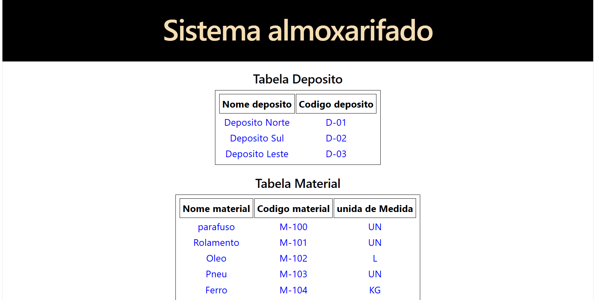
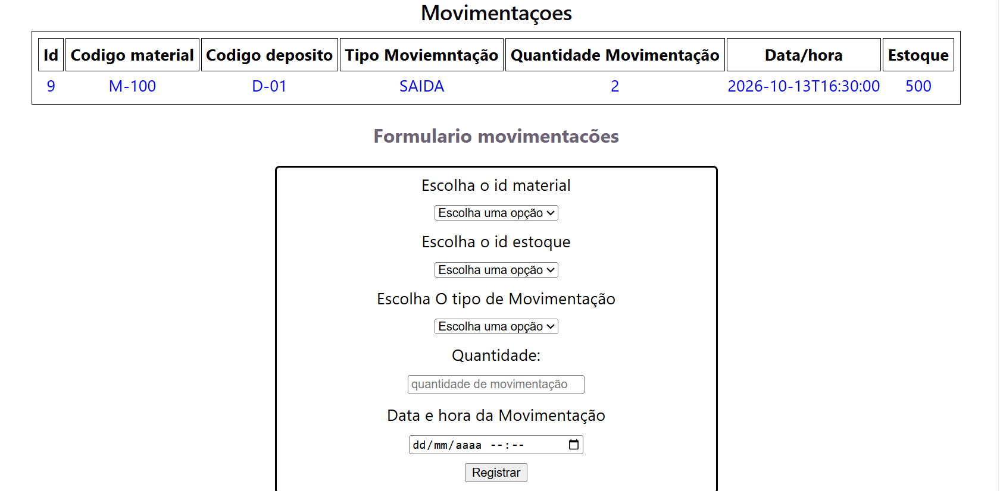
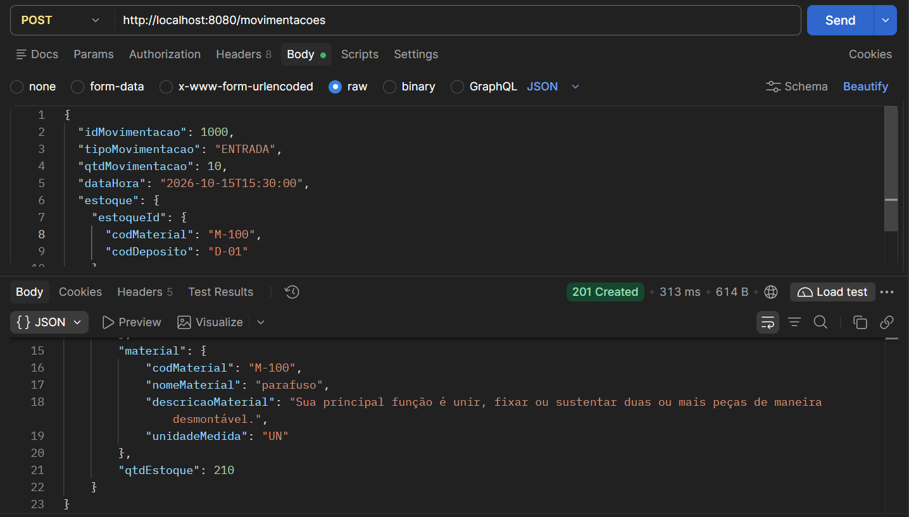
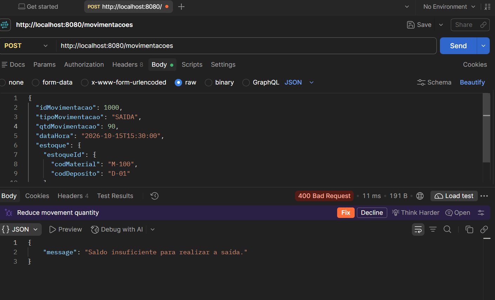
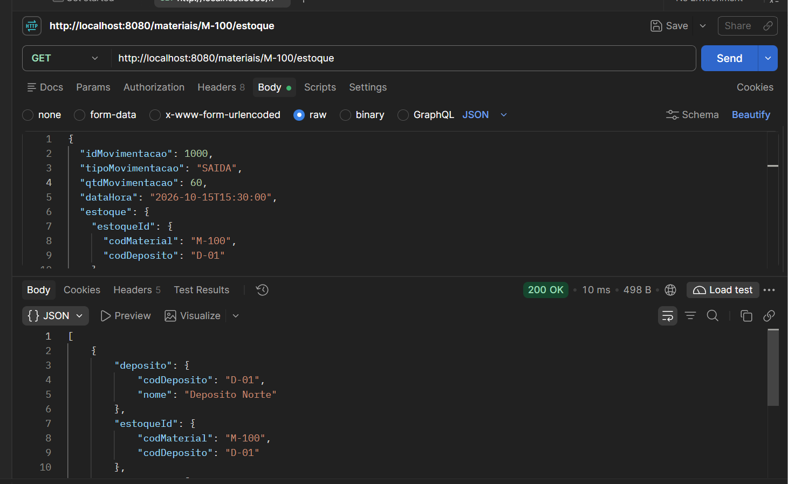
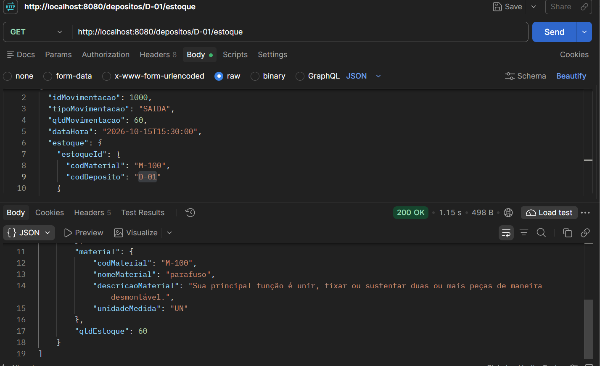
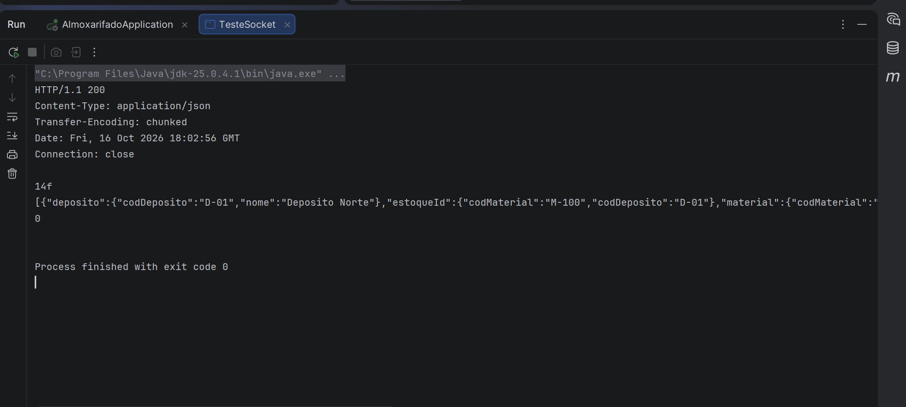

## Sistema de Almoxarifado

Sistema de gerenciamento de almoxarifado desenvolvido com Java, Spring Boot e React, com o objetivo de praticar desenvolvimento de APIs REST, modelagem de dados, SQL e integração entre back-end e front-end.
## Objetivo

Controlar materiais, depósitos, quantidades em estoque e movimentações de entrada e saída, mantendo a integridade dos dados e evitando movimentações que deixem o estoque negativo.

## Visão geral do sistema

## Formulário de movimentações

## Tecnologias utilizadas

## Back-end
- Java
- Spring Boot
- Spring Data JPA
- Hibernate
- SQL
- H2 Database
- Maven

## Front-end
- React
- JavaScript
- HTML
- CSS
- Vite

## Funcionalidades

- Visualização dos depósitos cadastrados.
- Visualização dos materiais e suas unidades de medida.
- Consulta de movimentações de estoque.
- Registro de movimentações por meio de formulário.
- Integração do front-end com a API REST.
- Validação de saídas para evitar estoque negativo no back-end.
- As funcionalidades listadas devem corresponder ao que já está implementado no projeto.

## Modelo de dados

O banco de dados é organizado em quatro tabelas principais:

- **deposito:** armazena os depósitos.
- **material:** armazena os materiais e suas informações.
- **estoque:** relaciona materiais e depósitos, registrando as quantidades disponíveis.
- **movimentacao:** registra as entradas e saídas de materiais.

A tabela `estoque` resolve o relacionamento muitos para muitos entre materiais e depósitos, utilizando uma chave primária composta pelos códigos do material e do depósito.

### Diagrama do modelo

## Como executar o projeto

## 1. Back-end

1. Instale um JDK compatível com a versão Java configurada no projeto.
2. Abra a pasta principal no IntelliJ IDEA.
3. Confira as configurações em src/main/resources/application.properties.
4. Execute a classe AlmoxarifadoApplication.
5. Verifique o console para confirmar que a aplicação iniciou sem erros.
6. Os scripts schema.sql e data.sql, localizados em src/main/resources, definem a estrutura do banco de dados e os dados iniciais.

## 2. Front-end

1. Instale o Node.js.

2. Abra a pasta frontend no VS Code.

3. Execute os comandos abaixo no terminal:

- npm install
- npm run dev

Acesse o endereço local exibido pelo Vite no terminal.

Verifique se o back-end está em execução e se a URL da API está configurada corretamente no front-end.

## Estrutura do projeto

almoxarifado/
## ├── src/                         # Back-end Java
- │   └── main/
- │       ├── java/
- │       └── resources/
- │           ├── application.properties
- │           ├── schema.sql
- │           └── data.sql
## ├── frontend/                    # Front-end React
- │   ├── src/
- │   ├── public/
- │   ├── package.json
- │   └── index.html
- ├── docs/                        # Documentação e imagens
- │   ├── modelo-dados.png
- │   ├── sistema-almoxarifado.png
- │   └── formulario-movimentacoes.png
- ├── evidencias/                  # Evidências dos testes da API
- ├── pom.xml
- └── README.md

## API REST

A aplicação disponibiliza endpoints para registrar movimentações e consultar o estoque por material ou depósito.

| Método | Endpoint | Descrição |
|---|---|---|
| POST | `/movimentacoes` | Registra uma movimentação de entrada ou saída e atualiza o estoque. |
| GET | `/materiais/{codigo}/estoque` | Consulta o estoque de um material nos depósitos. |
| GET | `/depositos/{codigo}/estoque` | Consulta os materiais e suas quantidades em um depósito. |

### Validações

- Impede saídas com quantidade superior ao estoque disponível.
- Utiliza chaves primárias e estrangeiras para manter a integridade dos relacionamentos.
- Retorna HTTP 400 quando uma saída excede a quantidade disponível, conforme validado nos testes.

## Evidências dos testes

Os endpoints foram testados utilizando o Postman, verificando as consultas de estoque e o registro de movimentações.

### 1. Registro de movimentação

### 2. Validação de saída com estoque insuficiente

### 3. Consulta de estoque por material

### 4. Consulta de estoque por depósito

### 5. Teste de comunicação HTTP com Socket Java

Além dos endpoints REST, foi desenvolvido um teste utilizando a classe `Socket` do Java para estabelecer uma conexão com a aplicação local na porta 8080, enviar uma requisição HTTP e ler a resposta recebida.

## Aprendizados

- Durante o desenvolvimento, foram praticados conceitos de:
- Modelagem de dados e relacionamentos entre tabelas.
- Chaves primárias, estrangeiras e chave primária composta.
- Criação de tabelas e inserção de dados utilizando SQL.
- Mapeamento objeto-relacional com JPA.
- Desenvolvimento e teste de APIs REST.
- Integração entre front-end e back-end.
- Componentes e gerenciamento de estado com React.
- Comunicação cliente-servidor utilizando Socket, TCP e HTTP.

## Status do projeto

Projeto em desenvolvimento, com back-end em Java e Spring Boot e interface em React. Novas funcionalidades e melhorias visuais poderão ser adicionadas progressivamente.