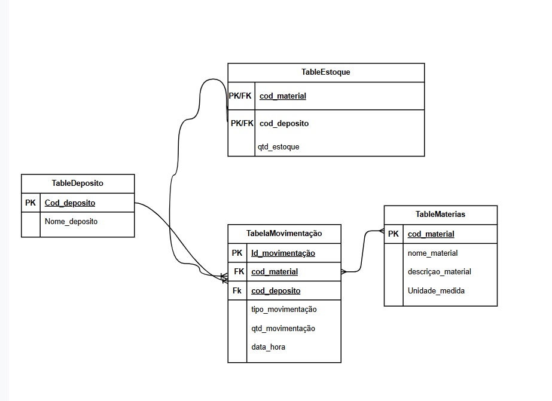

# Almoxarifado

Sistema de gerenciamento de almoxarifado desenvolvido com Java e Spring Boot, como projeto prático para aplicação de conceitos de modelagem de dados, SQL, JPA e desenvolvimento de APIs REST.

## Objetivo

Controlar materiais, depósitos, quantidades em estoque e movimentações de entrada e saída, mantendo a integridade dos dados e evitando movimentações que deixem o estoque negativo.

## Tecnologias utilizadas

- Java
- Spring Boot
- Spring Data JPA
- Hibernate
- SQL
- H2 Database
- Maven

## Modelo de dados

O banco de dados é organizado em quatro tabelas principais:

- **deposito:** armazena os depósitos.
- **material:** armazena os materiais e suas informações.
- **estoque:** relaciona materiais e depósitos, registrando as quantidades disponíveis.
- **movimentacao:** registra as entradas e saídas de materiais.

A tabela `estoque` resolve o relacionamento muitos para muitos entre materiais e depósitos, utilizando uma chave primária composta pelos códigos do material e do depósito.

### Diagrama do modelo

## Como executar o projeto

1. Clone o repositório.
2. Abra o projeto na IDE de sua preferência, como o IntelliJ IDEA.
3. Confira as configurações de conexão com o banco no arquivo `src/main/resources/application.properties`.
4. Execute a classe `AlmoxarifadoApplication`.
5. Verifique o console para confirmar que a aplicação iniciou sem erros.

Os scripts `schema.sql` e `data.sql`, localizados em `src/main/resources`, definem a estrutura do banco de dados e os dados iniciais.

## Estrutura do projeto

- `src/main/java/`: código-fonte Java.
- `src/main/resources/application.properties`: configurações da aplicação.
- `src/main/resources/schema.sql`: criação das tabelas e restrições.
- `src/main/resources/data.sql`: inserção dos dados iniciais.
- `docs/modelo-dados.png`: diagrama do modelo de dados.
- `evidencias/`: capturas de tela dos testes realizados.
- `respostas.md`: respostas e justificativas técnicas do desafio.

## API REST

A aplicação disponibiliza endpoints para registrar movimentações e consultar o estoque por material ou depósito.

| Método | Endpoint | Descrição |
|---|---|---|
| POST | `/movimentacoes` | Registra uma movimentação de entrada ou saída e atualiza o estoque. |
| GET | `/materiais/{codigo}/estoque` | Consulta o estoque de um material nos depósitos. |
| GET | `/depositos/{codigo}/estoque` | Consulta os materiais e suas quantidades em um depósito. |

### Validações

- Impede saídas com quantidade superior ao estoque disponível.
- Utiliza chaves primárias e estrangeiras para manter a integridade dos relacionamentos.
- Retorna HTTP 400 quando uma saída excede a quantidade disponível, conforme validado nos testes.

## Evidências dos testes

Os endpoints foram testados utilizando o Postman, verificando as consultas de estoque e o registro de movimentações.

### 1. Registro de movimentação

)

### 2. Validação de saída com estoque insuficiente

### 3. Consulta de estoque por material

### 4. Consulta de estoque por depósito

### 5. Teste de comunicação HTTP com Socket Java

Além dos endpoints REST, foi desenvolvido um teste utilizando a classe `Socket` do Java para estabelecer uma conexão com a aplicação local na porta 8080, enviar uma requisição HTTP e ler a resposta recebida.

## Aprendizados

Durante o desenvolvimento, foram praticados conceitos de:

- Modelagem de dados e relacionamentos entre tabelas.
- Chaves primárias, chaves estrangeiras e chave primária composta.
- Criação de tabelas e inserção de dados utilizando SQL.
- Mapeamento objeto-relacional com JPA.
- Desenvolvimento e teste de APIs REST.
- Comunicação cliente-servidor utilizando Socket, TCP e HTTP.

## Status do projeto:

Desafio prático desenvolvido para consolidar conhecimentos em Java, banco de dados e desenvolvimento de APIs REST.